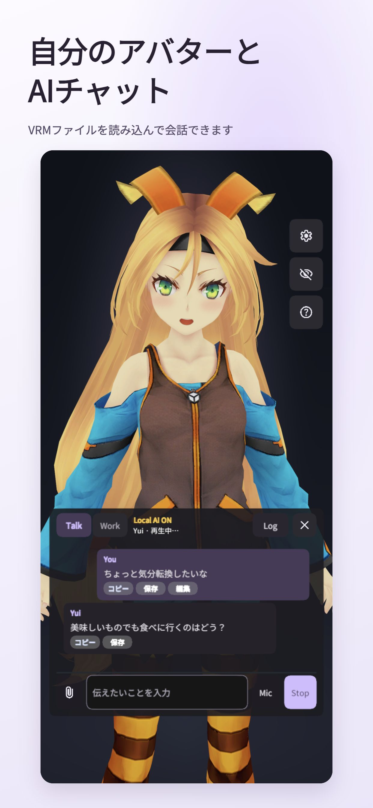
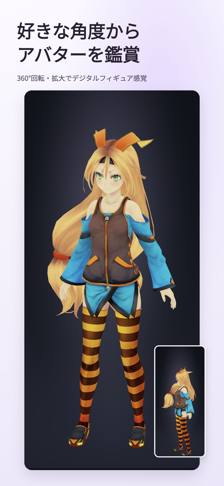
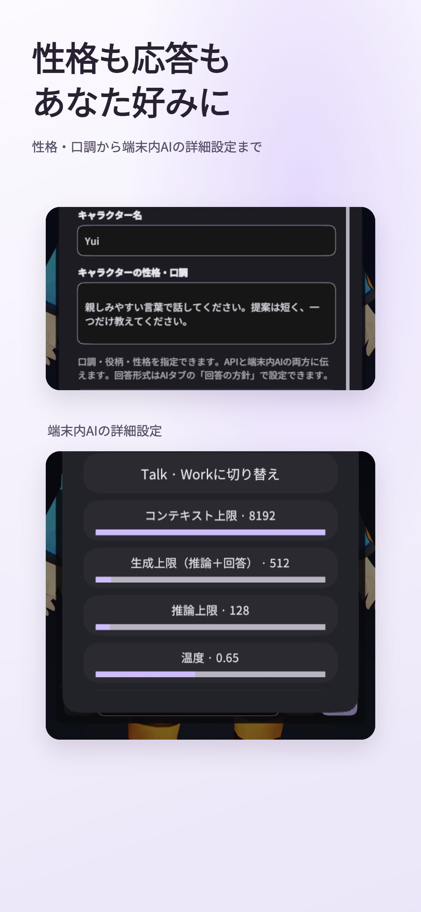
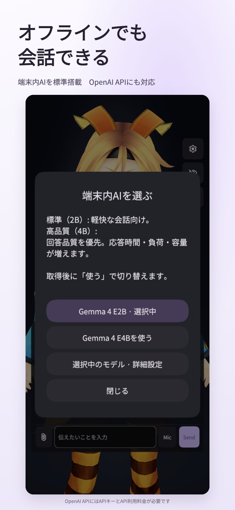

# Yui VRM AI Studio

[日本語](README.md) · [Help](docs/HELP.md) · [Report an issue](https://github.com/Tsubame-chan/YuiVRMAIStudio/issues)

**Make your favorite VRM avatar your conversation partner.**

Import your avatar for AI conversation, advice and small tasks. Describe its personality and speaking style in your own words. No avatar yet? Start with the included Unity-chan.

  
  

## What you can do

- **Bring your own appearance.** Import VRM avatars. Change outfits while keeping the same character's personality and memories.
- **Choose its personality and replies.** Give instructions such as “be more friendly” or “start with the conclusion.” Advanced local-AI settings are also available.
- **Keep the conversation going.** Character memories are saved on your device and used across restarts and AI switches. View, edit or delete them.
- **Enjoy the avatar from any angle.** Switch to the viewer to rotate and zoom, like a digital figure.

See personality and AI settings

  
  

The images show the real app with the included Unity-chan. Captions are Japanese; the app has Japanese and English menus. Layout varies by device and window size.

## Download

| Your device | Download |
| --- | --- |
| Mac | [macOS app ZIP](https://github.com/Tsubame-chan/YuiVRMAIStudio/releases/download/v0.2.6-beta.1/YuiVRMAIStudio_MacOSPublicBeta_v0.2.6-beta.1_macos.zip) (Apple Silicon runtime) |
| Windows | [Windows app ZIP](https://github.com/Tsubame-chan/YuiVRMAIStudio/releases/download/v0.2.6-beta.1/YuiVRMAIStudio_WindowsPublicBeta_v0.2.6-beta.1_windows.zip) |
| iPhone / iPad | iOS 26+. [App Store](https://apps.apple.com/jp/app/id6815341780): free Japan release |

[Release list, Backend ZIPs and checksums](docs/DOWNLOADS.md). Extract the ZIP, open the app and follow first-run setup. Allow approximately 2.5GB of downloads plus room for extraction. Developer ID signing/notarization is not provided for Mac. Setup: [Mac](docs/MAC_PUBLIC_BETA.en.md) / [Windows](docs/SETUP_GUIDE.md).

**GitHub's “Code → Download ZIP” is source code.** To use the app, choose a download above.

## Get started

1. Send a message to begin. Use Talk for short conversations, or Work for longer advice and tasks.
2. Change personality, voice and avatar in Settings. Your own avatar needs a **VRM file**. See [avatar preparation and import](docs/AVATAR_IMPORT.en.md).
3. Replay the tutorial from Help whenever you need it.

Choose **offline, on-device AI** or **OpenAI API**. The lightweight E2B model is standard; Mac, Windows and iOS offer optional E4B for better responses at the cost of longer waits and higher device load. OpenAI API is recommended for higher-quality conversation. **An API key and API charges are required**, separately from a ChatGPT subscription.

Standard speech uses five Japanese VOICEVOX voices. Mac/iOS offer optional Japanese Irodori and English Kokoro downloads in Settings. See [voice downloads](docs/LOCAL_AI_ASSETS.md). Windows NVIDIA users can add Irodori through the [Backend Console](docs/BACKEND_ASSET_DOWNLOADS.md#english). For saved voices, paired sync and extra engines, see [Backend Console](docs/BACKEND_CONSOLE.md) and [TTS setup](docs/BACKEND_TTS_GUIDE.md).

## Additional models

Settings → AI → **On-device AI · Choose or add model** provides Models, Add and Settings tabs. Compatible models run on the supported device, without a Backend or separate model server. You can switch back to standard Gemma.

- Mac imports single GGUF and compatible LiteRT-LM files. Windows imports compatible LiteRT-LM; its GGUF runtime is not bundled. iOS model import is development-only and is not included in the published app. Android support is future work.
- From Hugging Face, download an appropriate `.gguf` or `.litertlm`. Bare `.safetensors`, split GGUF and separate vision/audio projectors are unsupported.
- Additional models are experimental. Large models may be slow, stop or close the app. Import checks that a reply follows the input; this does not guarantee quality or universal compatibility.

See [instructions and runtime limits](docs/LOCAL_MODEL_IMPORT.md) and [Backend acquisition](docs/HELP.md). Available on desktop. See [device compatibility](docs/RUNTIME_SUPPORT.md) for released versus development-only iOS features.

See [release notes](docs/DOWNLOADS.md#更新履歴--release-notes) for changes and [Backend updates](docs/BACKEND_UPDATE.md) for migration.

## Memory and privacy

Memories are separate for each character. Sync-capable apps can share personality, memories and history through a Backend after pairing and confirming the changes. See [device compatibility](docs/RUNTIME_SUPPORT.md) for supported versions and setup. Secret mode reads existing memories without saving the new conversation. When you choose an external API, conversation and relevant personality settings/memories are sent to that service.

AI replies and memory retrieval can be wrong. Check important information. [How memory works](docs/CONVERSATION_IDENTITY.md) · [Privacy](docs/PRIVACY.md)

[Device compatibility](docs/RUNTIME_SUPPORT.md) · [AI and voice downloads](docs/LOCAL_AI_ASSETS.md)
